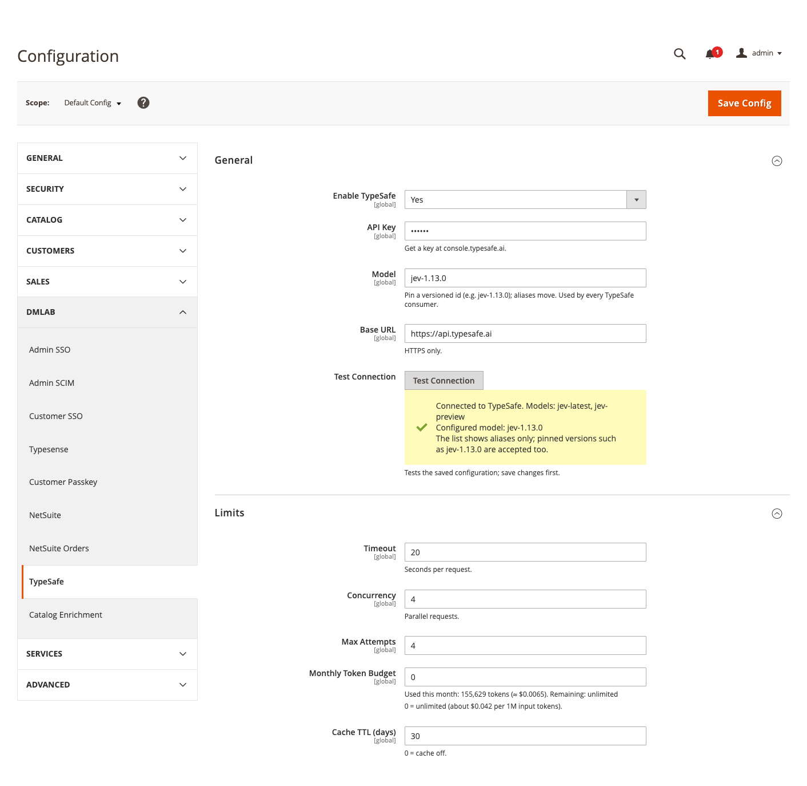

# DmLab_TypeSafeCore

> TypeSafe (Jev) AI client for Magento 2 — one connection, cache and token budget shared by every DMLab AI module.

[](https://github.com/dmlab-work/module-typesafe-core/actions/workflows/ci.yml) [](https://codecov.io/gh/dmlab-work/module-typesafe-core) [](https://packagist.org/packages/dmlab/module-typesafe-core) [](https://packagist.org/packages/dmlab/module-typesafe-core) [](https://packagist.org/packages/dmlab/module-typesafe-core) [](LICENSE) 

AI catalog modules need an AI account, and nobody wants a surprise bill. This module gives Magento one place for
your own [TypeSafe](https://typesafe.ai) key, a monthly spend cap with this month's cost shown in the admin, and a
cache so the same question is never paid for twice. It is what DMLab AI catalog modules use to talk to TypeSafe;
on its own it changes nothing in your catalog or storefront.



## Install
```bash
composer require dmlab/module-typesafe-core
bin/magento module:enable DmLab_TypeSafeCore
bin/magento setup:upgrade
```
Then **Stores → Configuration → DMLab → TypeSafe**: enable, paste the key, *Test Connection*.

```bash
bin/magento dmlab:typesafe:ping                     # check the connection
bin/magento dmlab:typesafe:usage [--month=YYYY-MM]  # requests, cache hits and tokens per module, monthly cost
```

## Requirements
Magento 2.4.7+ · PHP 8.2–8.5 · `ext-curl` · outbound HTTPS to the TypeSafe API.

## What you get
- **Your own key** — register at [console.typesafe.ai](https://console.typesafe.ai) and pay TypeSafe directly
  (about $0.042 per 1M input tokens). The key is stored encrypted in Magento; we never see it.
- **Settings in one place** — enable, API key, pinned model version (`jev-1.13.0`), Test Connection.
- **Spend control** — a monthly token budget with this month's usage and cost shown under the field; a response
  cache with a configurable lifetime.
- **Usage report** — requests, cache hits and tokens per consuming module, with the estimated cost, per month.

## Data and privacy
Only the text a consuming module puts into a request is sent to TypeSafe (US-hosted API). Request and response
content is never logged. Zero data retention is available on TypeSafe's enterprise plan.

Pairs with [Catalog Enrich](https://github.com/dmlab-work/module-catalog-enrich), which fills empty product
attributes from descriptions.

## Architecture
TypeSafe answers structured questions about text — yes/no, pick one of N options, score on a scale — with
calibrated probabilities instead of free-form output. Consumers call `DmLab\TypeSafeCore\Api\ClientInterface`:
```php
$response = $client->evaluate(new Request(
    ['title' => 'Merino wool crew sweater', 'description' => '…'],
    [
        'is_apparel' => new NoulQuestion('Is this product clothing?'),
        'material' => new ChoiceQuestion('Main material', ['wool' => null, 'cotton' => null, 'synthetic' => null]),
    ],
    'my_module' // usage is accounted per consumer
));
$response->getAnswer('is_apparel')->getProbability(); // 0..1
$response->getAnswer('material')->getChoice();        // 'wool', with getConfidence()
```
`evaluateMany()` sends a batch in parallel (curl_multi, bounded by *Concurrency*) and returns a `Response` or a
`TypeSafeException` per key; it never throws. Use `Api\ConfigInterface::isConfigured()` / `getModel()` instead of
your own settings, and `Api\UsageInterface` for the remaining budget.

Transient failures are retried with backoff up to *Max Attempts*, a rate-limit response pauses requests, and a
circuit breaker stops calls after repeated failures, so an API hiccup never floods the API or your logs.

## License
[OSL-3.0](LICENSE)
